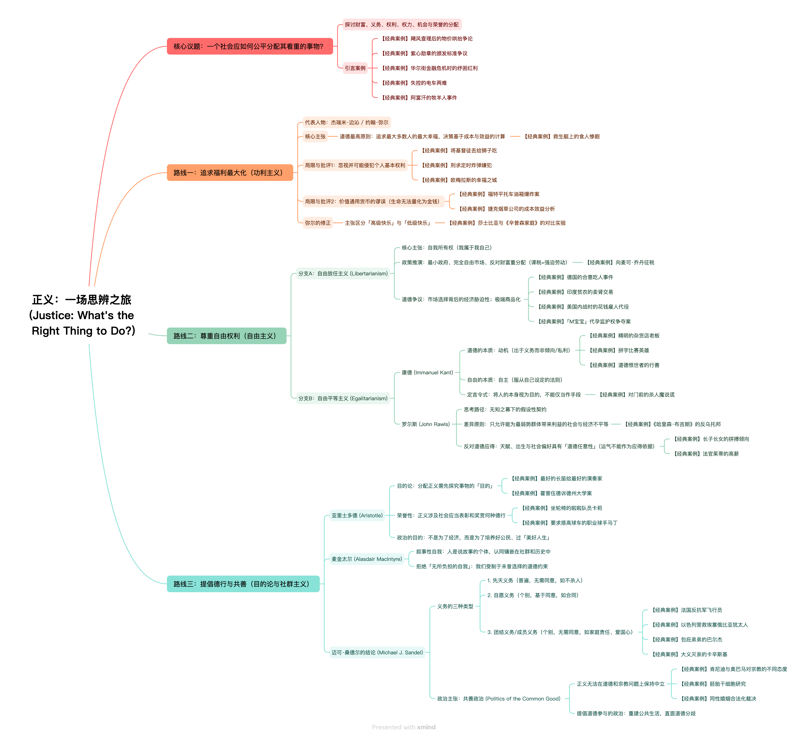

> [!NOTE]
> 本文在 Google NotebookLM 的协助下完成

**核心议题：什么是正义？**
探讨一个社会是否公正，就是在问这个社会如何分配我们重视的事物（收入与财富、义务与权利、权力与机会、职位与荣誉）。本书作者迈可·桑德尔通过一系列道德两难困境，引导读者探究了三种思考正义的方式：**追求福利最大化、尊重自由、提倡德行**。
* 【经典案例】飓风查理后的物价哄抬争论：佛州灾后冰块价格飙升，引发了人们基于自由市场福利、买家选择自由与制裁贪婪德行的不同主张冲突。
* 【经典案例】紫心勋章的颁发标准：军方是否该把勋章颁给患有心理创伤的老兵，触及了该勋章究竟是表彰勇敢还是表彰流血牺牲的德行争论。
* 【经典案例】华尔街纾困红利：民众愤怒不仅是因为纳税钱被用于奖赏贪婪，更是因为政府竟然出资奖赏了导致灾难的「失败者」。
* 【经典案例】失控的电车两难：你是该将电车转向撞死一人以救五人，还是该把桥上的胖子推下去挡车，挑战了我们对杀人与救人原则在不同情境下的直觉一致性。
* 【经典案例】阿富汗的牧羊人事件：海豹突击队因不忍杀害无武装牧羊人而全军覆没，展现了真实世界里结果不确定时令人悔恨的道德困境。

## 一、 追求福利最大化：功利主义 (Utilitarianism)
* **核心思想：** 道德的最高原则就是追求幸福的最大化，即整体的快乐应当超越痛苦（最大多数人的最大幸福）。
* **杰瑞米·边沁：** 认为快乐和痛苦是人类的「最高主宰」，所有的道德和政治选择都应基于成本效益分析。
  * 【经典案例】救生艇上的食人惨剧：四名水手遇船难，三人为了生存吃掉虚弱的服务员，逼问了道德是否仅是计算活命人数与成本效益的总和。
* **约翰·弥尔：** 试图挽救功利主义的缺陷，提出从长远来看，尊重个人自由会带来最大的社会福利；并主张区分「高等快乐」与「低等快乐」（「宁愿当不满足的苏格拉底，也不当个满足的傻瓜」）。
  * 【经典案例】莎士比亚与《辛普森家庭》的对比实验：多数学生虽觉得搞笑卡通更轻松，但仍承认莎士比亚是更高品质的追求，印证了人类具有分辨高级快乐的能力。
* **局限性1：未能尊重个人基本权利**。
  * 【经典案例】将基督徒丢给狮子吃：罗马竞技场上为了取悦无数观众而让基督徒惨死，暴露了功利主义可能会为了多数人的快乐而把侵犯个人权利合理化。
  * 【经典案例】刑求定时炸弹嫌犯：为了拯救多数人而对恐怖嫌犯甚至其毫不知情的无辜女儿严刑拷打，检验了我们在极端情况下对功利原则的底线。
  * 【经典案例】欧梅拉斯的幸福之城：全城的繁荣快乐如果必须建立在一个被关在地窖里受苦的无辜孩子身上，这种情境直击了侵害基本人权换取总体幸福的道德底线。
* **局限性2：错误地将所有道德价值简化为单一的通用货币尺度（例如为人的生命标价）**。
  * 【经典案例】福特平托车油箱爆炸案：企业计算修改油箱的安全成本高于伤亡赔偿的金钱成本，突显了将生命折算为单一金钱尺度带来的道德反感。
  * 【经典案例】捷克烟草公司的成本效益分析：烟草公司计算抽烟者早逝能为政府省下大量养老与住房支出，暴露了价值通用货币逻辑的彻底荒谬。

## 二、 尊重自由：自由主义 (Liberalism)
这一派别认为，正义即是尊重自由与个人权利，但在「何种权利最重要」上存在分歧，分为两支：

**1. 自由放任主义 (Libertarianism)**
*   **核心思想：** 基于**自我所有权**（我属于我自己，因此我拥有我的劳动力和劳动成果），主张不受约束的自由市场和「最小政府」。
*   **主张：** 反对家长式立法（如强制系安全带）、反对道德性立法、强烈反对为了帮助穷人而向富人征税（认为课税等同于强迫劳动甚至奴役）。代表人物包括海耶克、傅利曼和诺齐克。
    *   【经典案例】向麦可·乔丹征税：在自由放任主义者看来，向高收入者征税以救济穷人等同于征收他们的劳动力，侵犯了个人对其劳动成果的自我所有权。
*   **局限性：** 推演到极致会导致难以接受的后果，例如合意吃人行为、出卖身体器官等。在贫富差距极大的情况下，看似自由的市场选择可能带有经济上的强制性。
    *   【经典案例】德国的合意吃人事件：如果人完全拥有自己身体的所有权，那么德国人自愿被别人吃掉在逻辑上就不应被政府禁止。
    *   【经典案例】印度贫农的卖肾交易：如果人拥有自己，那么印度穷苦农民为了供孩子上学卖掉第二个肾（即卖命），在逻辑上也必须被允许。
    *   【经典案例】美国内战时的花钱雇人代役：用市场机制招募士兵（包括现今的志愿军），对于底层穷人而言可能只是由于缺乏其他选项而被迫为之，带有经济上的强制性。
    *   【经典案例】「M宝宝」代孕监护权争夺案：将女性的生育能力与儿童视为可在市场上买卖的商品，引发了人的同意是否真正在免于经济压迫下做出、以及生育是否被商品化贬低的激烈争论。

**2. 自由平等主义 (Egalitarianism)**
*   **伊曼纽尔·康德：** 认为道德不在于后果，而在于**动机**（只有为了正确理由而做出的「义务动机」才具有道德价值）。自由不是随心所欲，而是**自主**（遵从自己为自己设定的法则）。他提出「定言令式」，要求我们把人（包括自己）当作目的来尊重，而不能仅仅当作手段。
    *   【经典案例】精明的杂货店老板：老板为了保住商誉而不欺骗买面包的小孩，证明了如果做正确的事只是为了私利，那这种行为就缺乏道德价值。
    *   【经典案例】拼字比赛英雄：男孩为了防止内心罪恶感而坦承拼写错误，说明如果诚实是为了自我感受好过，其道德价值也会打折扣。
    *   【经典案例】道德恨世者的行善：心如死灰的恨世者抛开冷漠去帮助别人，这种极端情况剥离了同情心，印证了只有单纯出于原则的「义务动机」才具真正的道德价值。
    *   【经典案例】对门前的杀人魔说谎：康德认为直接说谎是错的，但像克林顿在性丑闻中精心设计的「误导性真话」因为仍勉强向诚实义务致敬，因此在道德上优于公然撒谎。
*   **约翰·罗尔斯：** 认为真实的契约往往因为权力、知识的不对等而不公平。他提出在**「无知之幕」**（不知道自己的阶级、天赋、种族等）掩盖下的初始平等状态中达成的假设性社会契约才是公正的。
*   **罗尔斯的正义原则：** 1. 平等的基本自由权；2. **差异原则**（只有在对社会最弱势成员有利的情况下，才允许社会和经济的不平等）。罗尔斯反对将分配正义建立在「道德应得」上，因为人的天赋才华和社会的喜好都是带有道德任意性的偶然因素（如运气）。
    *   【经典案例】《哈里森·布吉朗》的反乌托邦：小说中为了平等强迫给天才戴上重物，罗尔斯的「差异原则」则主张不强行阻碍天才奔跑，但要求他们必须利用天赋来帮助社会弱势群体。
    *   【经典案例】长子长女的拼搏倾向：连「努力」的意愿也受出生次序等偶然因素影响，说明了成功是运气而非纯粹的「道德应得」。
    *   【经典案例】法官茱蒂的高薪：个人才能带来的财富高低完全取决于当下社会碰巧重视什么（如重视电视明星高于教师），印证了社会偏好具有极大的道德任意性。

## 三、 提倡德行与共善：目的论与社群主义 (Communitarianism)
*   **亚里士多德的目的论：** 正义具有**目的性**和**荣誉性**。要决定如何分配某种事物（如长笛或大学入学名额），必须先探讨该事物的「目的」是什么，以及它应当表彰哪些相关的德行。他认为政治的目的不是为了经济交换，而是为了培养良好的公民，促进美好人生。
    *   【经典案例】最好的长笛给最好的演奏家：这种思维要求我们先确认长笛「为了奏出美妙音乐」的本质目的，才能决定最杰出的乐手最该获得它。
    *   【经典案例】坐轮椅的啦啦队员卡莉：为了决定她能否参与，必须先争辩啦啦队这项活动的核心目的究竟是体操特技还是激发观众热情的本质。
    *   【经典案例】要求搭高球车的职业球手马丁：法庭对规则的审判，直接触及了高尔夫球这项社会惯例究竟应当表彰何种「德行」的荣誉感之争。
    *   【经典案例】霍普伍德诉德州大学案：白人女学生因学校优先录取少数族裔而落榜，引出了大学录取究竟是为了奖赏个人功绩，还是为了实现促进社会多元性的「机构目的」的争论。
*   **麦金太尔的叙事性自我：** 反对自由主义「无所负担的自我」假定。他指出人是「说故事的个体」，我们的认同是镶嵌在家庭、城市、部落和国家的历史中的。
*   **迈可·桑德尔的结论（共善政治）：** 桑德尔支持这一路径。他认为除了天赋的「先天义务」和同意的「自愿义务」外，我们还承担着**「团结义务」（或成员义务）**，如爱国心、对家人的忠诚、为国家历史过错道歉的集体责任等，这些都不以个人同意为前提。
    *   【经典案例】法国反抗军飞行员：飞行员拒绝执行轰炸自己家乡的任务，证明了我们因共同历史，对同胞负有超越普遍原则的「特殊团结义务」。
    *   【经典案例】以色列营救埃塞俄比亚犹太人：以色列优先发起了从苏丹营救同族难民的行动，印证了我们天然承认社群纽带与优先援助同胞的责任。
    *   【经典案例】包庇弟弟的巴尔杰：哥哥为了家庭忠诚而拒绝向警方透露黑帮逃犯弟弟的下落，展现了特殊情谊的道德拉扯。
    *   【经典案例】大义灭亲的卡辛斯基：弟弟向警方举报了身为炸弹客的亲哥哥，深刻展现了当家庭忠诚与将罪犯绳之以法的普遍义务发生剧烈冲突时的道德两难。
*   **正义无法保持中立：** 探讨正义问题不可避免地会卷入对道德、荣誉、德行和美好人生的争论。一个公正的社会不仅要追求效用或自由，还必须共同推理美好人生的意义，培养公民德行，重建公共生活，拥抱「道德参与的政治」。
    *   【经典案例】肯尼迪与奥巴马对宗教的不同态度：前者承诺信仰绝不干涉执政，后者呼吁不该放弃宗教论述，反映了时代在「政府是否该在道德上保持中立」这一立场上的深刻变迁。
    *   【经典案例】胚胎干细胞研究：揭示了如果法律不先直面「胎儿何时算作人」这一充满争议的道德和宗教议题，就根本无法确立政策。
    *   【经典案例】同性婚姻合法化裁决：法院支持同婚是直接介入了对婚姻目的（生育还是相互承诺的爱）的道德重塑，证明了正义论述不可能脱离美好人生的探讨。

---
