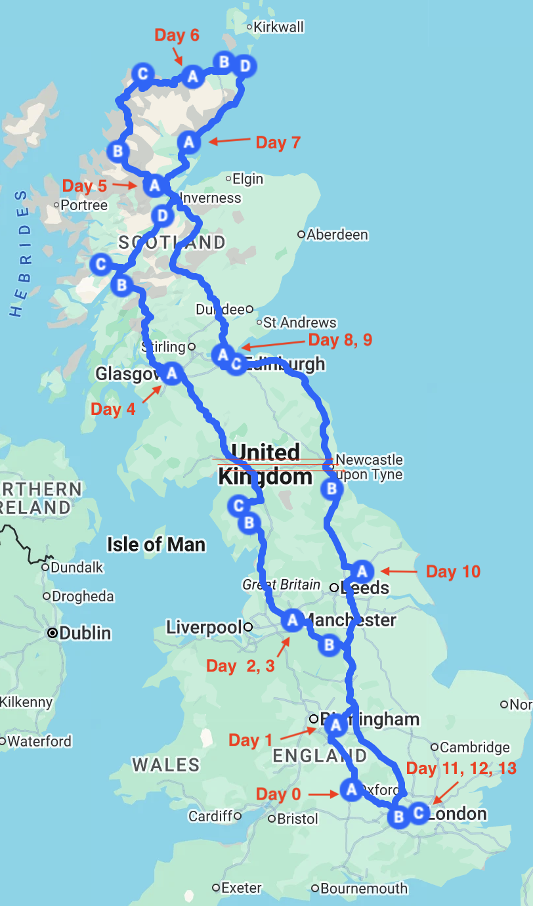

## 路线总览

## 行程
### Day 0（2026.8.14）
活动：英航 BA168，11:00～18:30。希思罗机场取车，驾车一个小时到牛津。

住宿：[牛津希尔顿欢朋](https://www.hilton.com/en/hotels/oxfhxhx-hampton-oxford/)

### Day 1（2026.8.15）
活动：开车到 Redbridge Park and Ride 集散中心停车（十分钟），换公交进城。重点参观了基督教堂学院、牛津自然博物馆，其他地方随意徒步参观。傍晚坐公交回 Redbridge Park and Ride 取车，开车到考文垂。

住宿：[考文垂诺富特](https://all.accor.com/hotel/0506/index.en.shtml)

### Day 2（2026.8.16）
活动：从考文垂北上，穿越峰区国家公园（Peak District National Park）。在 Endsor 古村停留，轻度徒步。傍晚到曼彻斯特。

住宿：[老特拉福德希尔顿花园酒店](https://www.hilton.com/en/hotels/manesgi-hilton-garden-inn-manchester-emirates-old-trafford)

### Day 3（2026.8.17）
活动：白天曼彻斯特老城徒步，下午阿提哈德球场参观。电车和步行出游。

住宿：[老特拉福德希尔顿花园酒店](https://www.hilton.com/en/hotels/manesgi-hilton-garden-inn-manchester-emirates-old-trafford)

### Day 4（2026.8.18）
活动：从曼彻斯特北上，穿越湖区国家公园（Lake District National Park），中间停留 Ambleside 和 Keswick，傍晚到达格拉斯哥。

住宿：[老特拉福德希尔顿花园酒店](https://www.hilton.com/en/hotels/manesgi-hilton-garden-inn-manchester-emirates-old-trafford)

### Day 5（2026.8.19）
活动：从格拉斯哥出来，沿 A82 景观公路进入苏格兰高地，景色壮丽的一天，中间停留格伦科（Glenco）峡谷、格伦芬南（Glenfinnan）、尼斯湖（Loch Ness），傍晚到达 Strathpeffer 小镇。

住宿：[The Highland Hotel by Compass Hospitality](https://highlandhotel.co.uk)

### Day 6（2026.8.20）
活动：从 Strathpeffer 往西北方向，开始 NC500 简化版旅程，这一天走完 NC500 的西北海岸线，荒原和峡湾，没有明确的停留点，随走随停，晚上到 Melvich 小镇。

住宿：[The Steading, Melvich](https://www.airbnb.com/rooms/50203483)

### Day 7（2026.8.21）
活动：NC 500 第二天，英伦最北端海岸，断崖和海蚀柱，晚上到东海岸的 Golspie 小镇。

住宿：[The old post office](https://www.booking.com/hotel/gb/the-old-post-office-golspie.en-gb.html)

### Day 8（2026.8.22）
活动：沿东海岸公路南下，先走西海岸，就觉得东海岸风景一般，完成 NC500 简化版，下午到达爱丁堡附近的小镇 Inverkeithing，入住，然后直接坐火车去爱丁堡，傍晚登卡尔顿山（Calton Hill）。

住宿：[Boreland Bridge Airbnb](https://www.airbnb.com/rooms/21473212)

### Day 9（2026.8.23）
活动：坐火车来回爱丁堡市中心，市区徒步，城堡、街头演出、大学、公墓等。

住宿：[Boreland Bridge Airbnb](https://www.airbnb.com/rooms/21473212)

### Day 10（2026.8.24）
活动：苏格兰结束，一路南下到约克，中间停留杜伦大学（Durham University），参观杜伦大教堂，傍晚参观约克古城。

住宿：[Premier Inn York City Centre (Layerthorpe) hotel](https://www.premierinn.com/gb/en/hotels/england/north-yorkshire/york/york-city-centre-layerthorpe.html)

### Day 11（2026.8.25）
活动：一路南下到希思罗机场，还车，地铁进伦敦。傍晚在国王十字买哈利波特纪念品。

住宿：[Premier Inn London Fulham hotel](https://www.premierinn.com/gb/en/hotels/england/greater-london/london/london-fulham.html)

### Day 12（2026.8.26）
活动：上午大英博物馆，下午威斯敏斯特市区徒步，晚上戈登拉姆齐餐厅打卡。

住宿：[Premier Inn London Fulham hotel](https://www.premierinn.com/gb/en/hotels/england/greater-london/london/london-fulham.html)

### Day 13（2026.8.27）
活动：上午参观威斯敏斯特教堂，下午泰晤士河南岸徒步，国家美术馆。傍晚到斯坦福桥球场打个卡，比赛日没法走近参观。找一个小酒馆，喝啤酒，看切尔西比赛。

住宿：[Premier Inn London Fulham hotel](https://www.premierinn.com/gb/en/hotels/england/greater-london/london/london-fulham.html)

### Day 14（2026.8.28）
活动：英航 BA169，12:05～07:55，回家。
